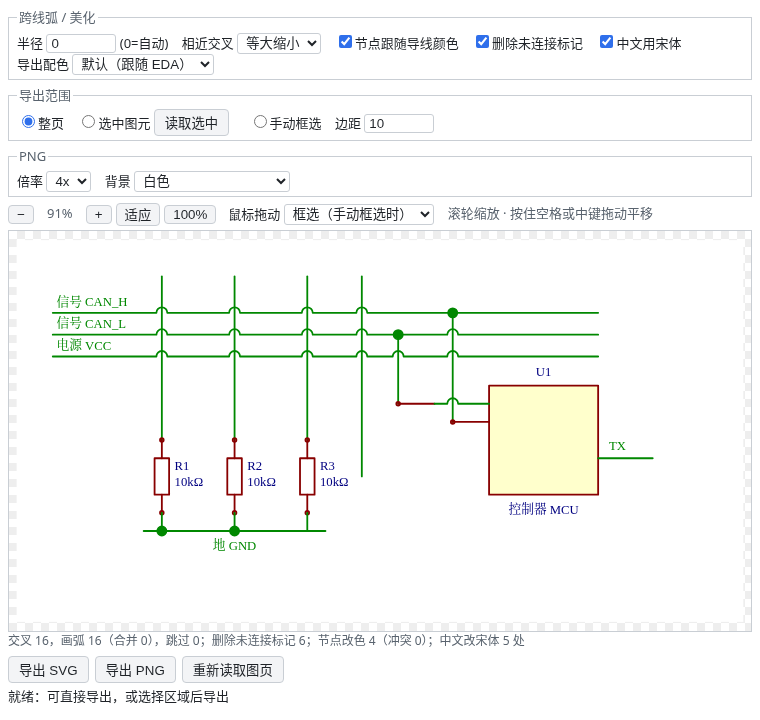
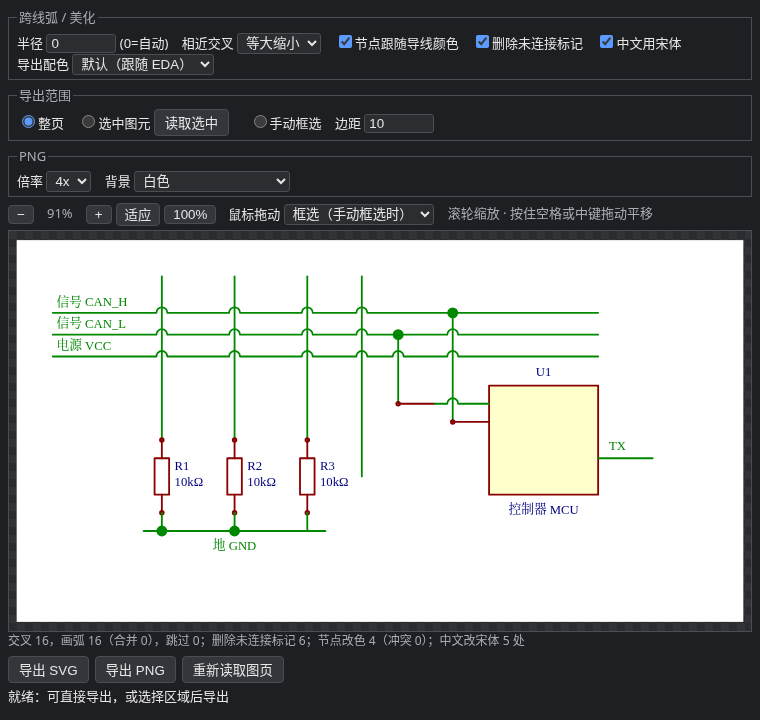
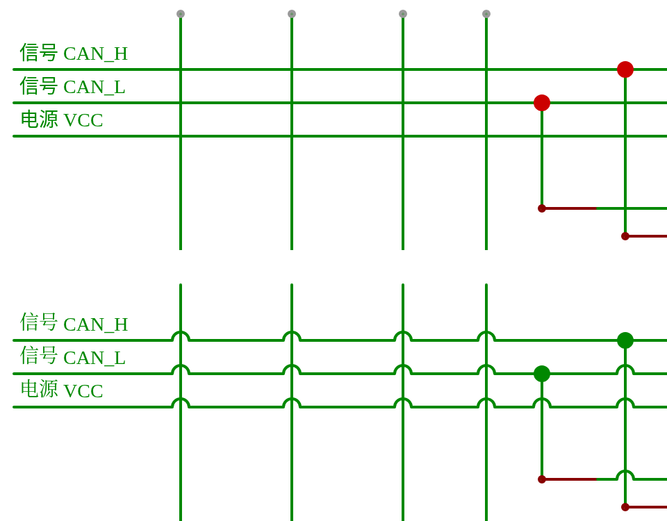
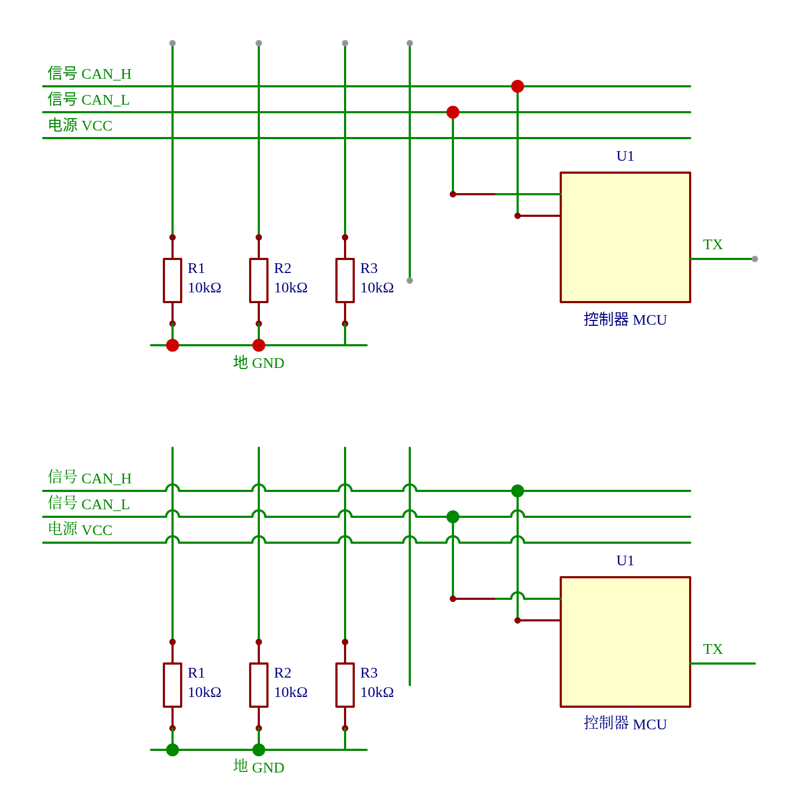

# 原理图美化导出 eda-sch-beautify

给 **嘉立创EDA专业版（EasyEDA Pro）** 原理图导出的 SVG / PNG 做"出版级"美化：

- 不相连的导线交叉处加 **半圆跨线弧**（KiCad 10 风格：水平线向上鼓；相邻交叉等大缩小或合并；避开节点/引脚/文字）
- **节点圆点跟随导线颜色**
- 删除灰色的 **未连接标记**
- **中文用宋体、英文保持 Times New Roman**（同一行混排也分别设置）
- 移除导出自带的整页背景，PNG 可选 **1x/2x/4x**、**透明 / 白色 / KiCad 纸色 #F5F4EF** 背景
- 可只导出 **选中图元** 或 **手动框选** 的区域

只处理导出的图片，**不修改原理图**。






示例原理图：[`examples/example.svg`](examples/example.svg)（虚构电路，由 `examples/gen_example.py` 生成）

## 两种用法

### 1. 嘉立创EDA 扩展（`extension/`）
构建：
```bash
cd extension
npm install
./build.sh            # 产物：build/dist/eda-sch-beautify_v<版本>.eext（同时复制到 dist/）
```
安装：嘉立创EDA专业版 V3「高级 → 扩展管理器 → 导入」（V2：「设置 → 扩展 → 扩展管理器 → 导入扩展」），选择 `.eext`，在「已安装」中启用并勾选「显示在顶部菜单」。
参考：<https://prodocs.lceda.cn/cn/api/guide/how-to-start.html>

使用：原理图编辑器顶部菜单「原理图美化」
- 快速导出美化 SVG（整页）
- 导出面板（PNG / 区域 / 设置）…

### 2. Python 命令行（`python/`）
```bash
pip install lxml
python3 python/eda_sch_beautify.py 原理图.svg 输出.svg         # 默认参数
python3 python/eda_sch_beautify.py -h                         # 全部参数
python3 python/render.py 输出.svg 输出.png 3000                # 用无头 Chrome 渲染预览（需安装 Chrome）
```
常用参数：`--r` 半径、`--close shrink|merge`、`--hop horizontal|vertical|auto`、`--junction-color wire|keep`、`--keep-end-markers`、`--font-mode split|element`、`--keep-font`、`--exclude-rect x,y,w,h`、`--axis-tol`、`--keep-background`。

## 识别规则（基于嘉立创EDA专业版导出实测）
| 元素 | SVG 表示 |
|---|---|
| 导线 | `<polyline c_partid="wire" points="…">` |
| 节点 | 实心 `<circle r="2.5" fill:#CC0000>` |
| 未连接标记 | `<circle r="1" stroke:#999999 fill:#999999B3>` |
| 引脚端点 | 空心 `<ellipse>`，引脚 `c_partid="part_pin"` |

扩展里的 TypeScript 核心（`extension/src/sch-beautify-core.ts`）与 Python 脚本输出一致，可用 `extension/test/run.ts` 在 Node 下核对。

## 已知限制
- 只处理水平/竖直导线（轻微偏斜在 `--axis-tol` 内按正交处理），斜线忽略
- 文字避让的文字范围按字号估算
- "选中图元"区域依赖 EDA 图元 ID 与 SVG 元素 ID 对应；对不上时退回 API 坐标换算（y 轴翻转假设），可改用手动框选

---

## English summary
**eda-sch-beautify** post-processes schematic SVG exported from JLCEDA / EasyEDA Pro: KiCad-style semicircle hop-overs at unconnected wire crossings, junction dots recolored to the wire color, gray "unconnected" markers removed, CJK text in SimSun while Latin stays Times New Roman, page background removed, PNG export at 1x/2x/4x with transparent / white / KiCad paper (#F5F4EF) background, and region export (selection or drag-box). Available as an EasyEDA Pro extension (`extension/`, build with `./build.sh`, import the `.eext` via the Extension Manager) and as a Python CLI (`python/eda_sch_beautify.py`). The schematic itself is never modified. License: MIT (SDK-derived scaffolding under Apache-2.0, see NOTICE).
