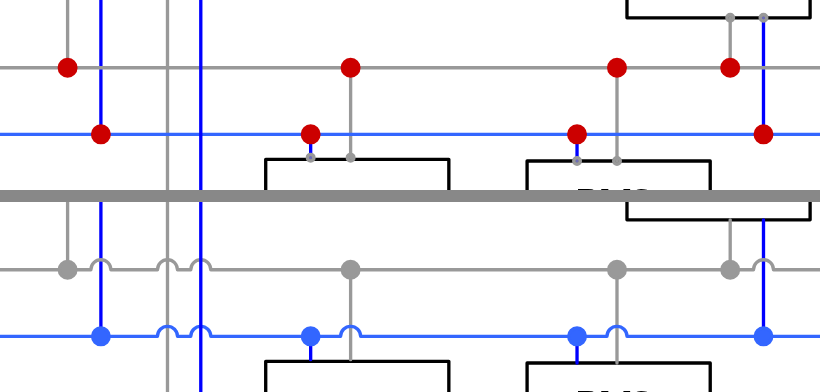
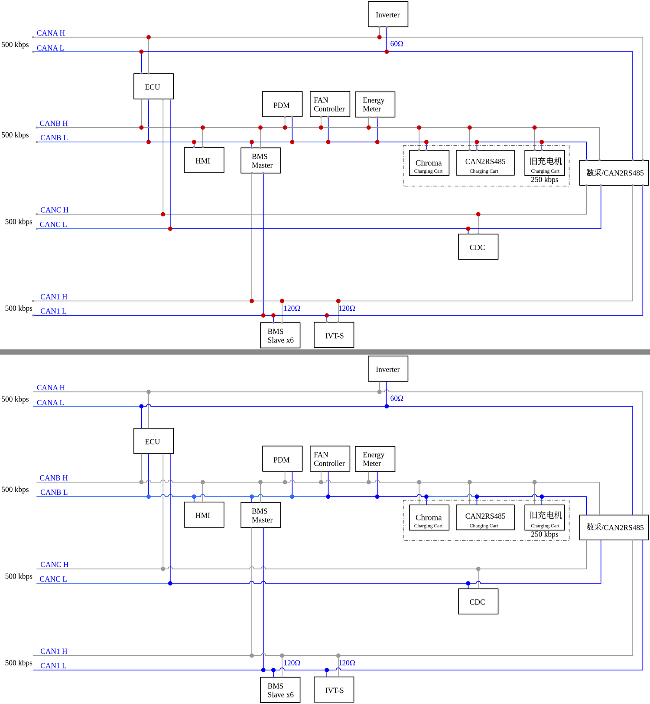

# 原理图美化导出

给嘉立创 EDA 专业版导出的原理图 SVG、PNG 做“出版级”美化。只处理导出的图片，不改原理图工程本身。

## 能做什么

- **半圆跨线弧**：不相连的导线交叉处加半圆跨线弧（KiCad 10 风格）。水平线向上鼓起。相邻的交叉会等大缩小，或者合并成一段。弧线智能避让节点、引脚和文字。
- **节点自动配色**：节点圆点自动改成所在导线的颜色。
- **标记清理**：自动删掉灰色的未连接标记（× 或未连接端点浅灰圆圈）。
- **混排字体优化**：中文用宋体，英文保持 Times New Roman。同一行里的中英文会智能分开设置。
- **背景底板智能剥离**：彻底清除原图纸自带的浅色底板，无缝支持透明、纯白、KiCad 复古纸色 `#F5F4EF` 或纯黑。你画的带描边的分组框、模块框不会被当成底板删掉。
- **真·黑白单色出版模式**：支持“白底黑线”，将全图所有走线与文字转换为纯黑高对比度单色，非常适合论文、专利与印刷报告；也支持“黑底白线”，会自动配纯黑背景。
- **灵活区域截取**：支持导出整页、选中图元（可自由调节边缘留白边距）、或在预览画板上手动自由框选。

## 选项与参数详解

1. **导出配色**：
   - **默认（跟随 EDA）**：保持原本原理图的多彩颜色。
   - **白底黑线**：将走线、引脚、文字、器件框线统一转换为高纯度黑色（#000000），适合论文、出版物与黑白打印。
   - **黑底白线**：将所有线条与文字反色转换为白色，适合暗黑风格展示。选择后背景会自动切到纯黑。
2. **边距（Margin）**：
   - 仅在选择 **【选中图元】** 导出时生效。
   - 表示在选中的电路模块外边界四周**额外留出的空白边距**（默认 10）。边距为 0 时会紧贴元件边缘，留出适当边距能让模块图更具视觉舒适度。
3. **PNG 背景底色**：
   - **KiCad 纸色 (#F5F4EF)**：经典米黄色温润纸底。
   - **纯白 (#FFFFFF)**：现代纯净白底。
   - **纯黑 (#000000)**：配合黑底白线。
   - **透明**：彻底无底色，导出透明背景 PNG / SVG。

## 怎么用

1. 先打开原理图编辑器里的一个图页。
2. 顶部菜单选择 **「原理图美化」**。
   - **“快速导出美化 SVG（整页）”**：快速导出当前图页并保存。
   - **“导出面板（PNG / 区域 / 设置）…”**：打开现代化交互导出面板，可自由调节倍率、背景、配色、边距并实时框选预览。
   - **“关于…”**：查看版本信息。

从扩展管理器安装后，请在“已安装”中启用本扩展，并**勾选「显示在顶部菜单」**。多图页导出如果得到的是压缩包，请改到单个图页里再导出。

## 面板

面板跟随 EDA 当前的深色或浅色主题。预览可以用滚轮缩放，也可以用 +、−、适应和 100%。按住空格、按住中键，或打开平移模式，可以拖动预览。放大后预览会在操作停下时重绘可视区，保持清晰。

PNG 会先按目标像素尺寸栅格化，背景铺满整张画布。透明模式导出的是真透明。

## 处理前后

## 限制

- 只处理水平和竖直导线。斜线会跳过。轻微偏斜的导线按正交导线处理。
- 文字避让用的范围按字号估算。
- “选中图元”要求 EDA 图元 ID 和 SVG 元素 ID 对得上。对不上时改用坐标换算。这时可以改用手动框选。

## 许可

MIT 许可证。
